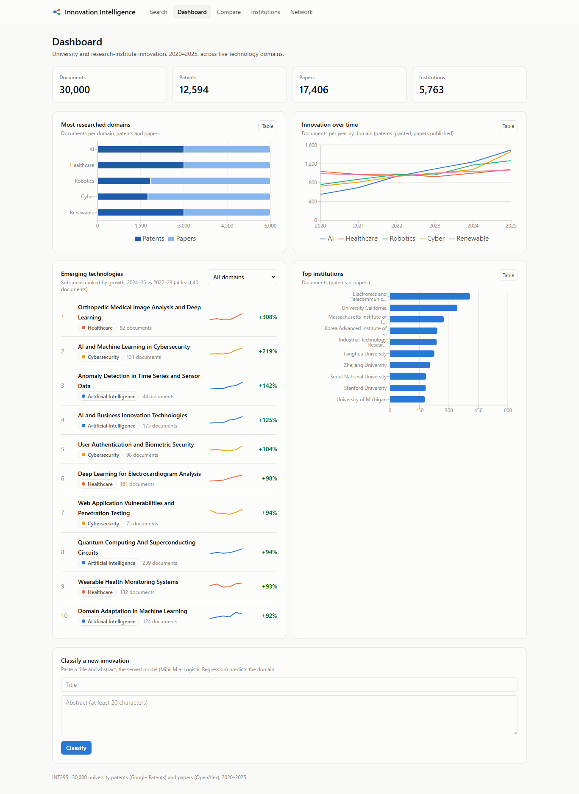
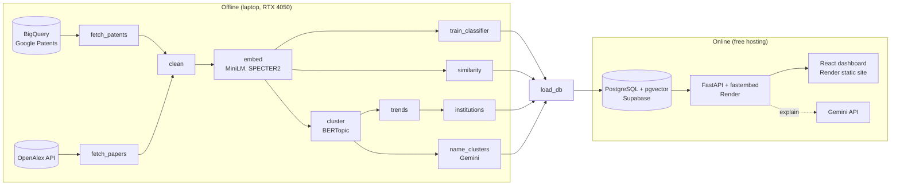
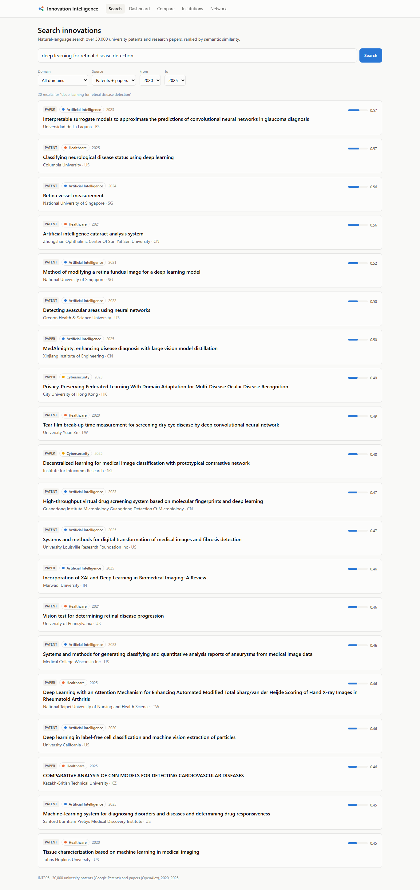
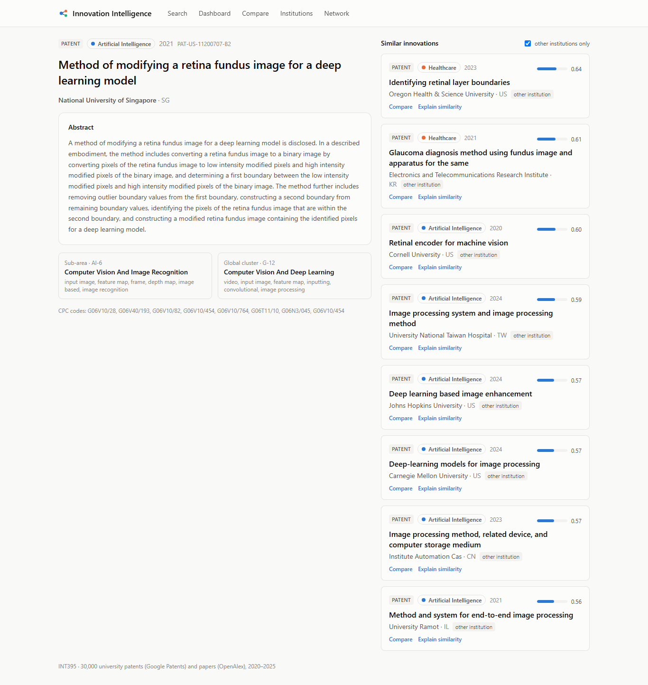
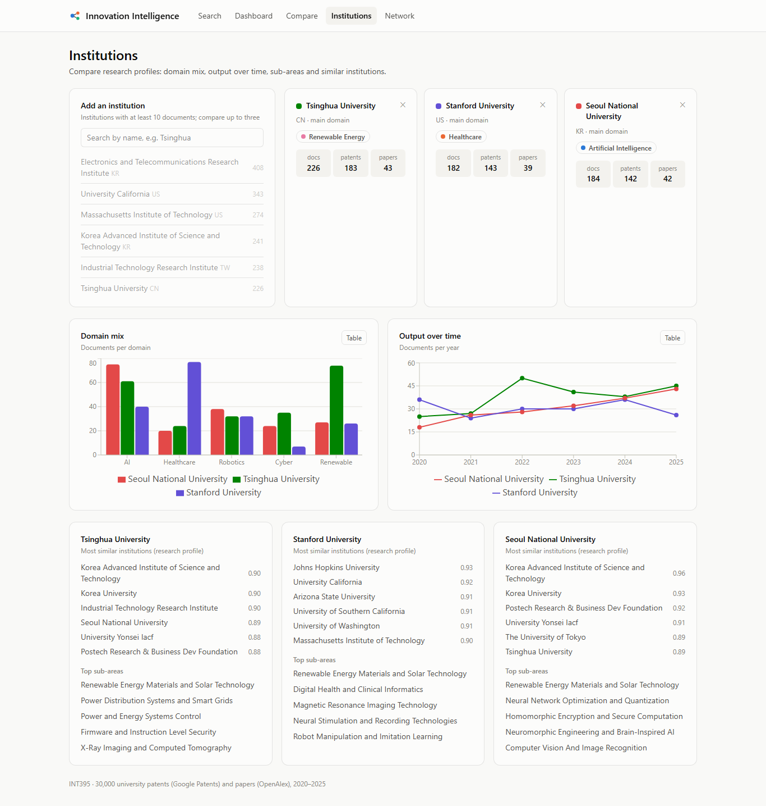
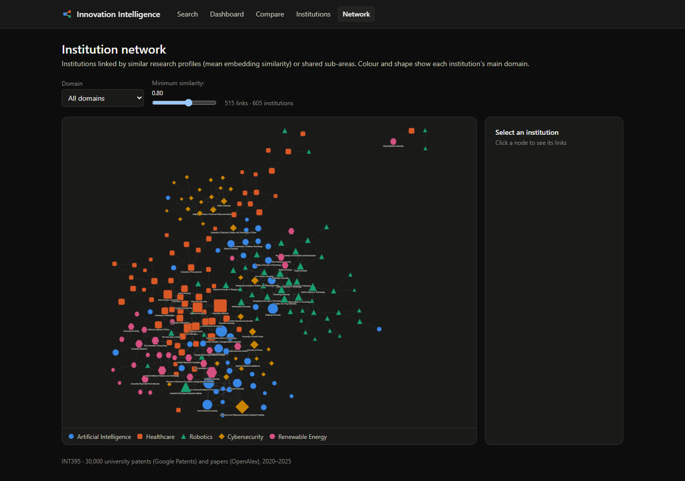

# Innovation Intelligence Platform

INT395 project. The platform analyses 30,000 patents and research papers from universities and research institutes (2020–2025). It classifies them into five technology domains: Artificial Intelligence, Healthcare, Robotics, Cybersecurity and Renewable Energy. Researchers can use it to search, compare and explore innovation trends.

- **Live site:** https://innovation-intelligence.onrender.com. The API is at https://innovation-intelligence-api.onrender.com/docs. The first visit after about 15 idle minutes takes 30–60 s while the free server wakes up.
- **Plan, phases and evaluation protocol:** [PLAN.md](PLAN.md); changes made during the build are in Section 10.
- **Results:** [reports/final_report.md](reports/final_report.md).



## Results at a glance

| Module | Result |
|---|---|
| Domain classification | Fine-tuned SciBERT: **test accuracy 0.954, macro F1 0.954**. The served MiniLM + Logistic Regression model scores 0.923. |
| Semantic search | Precision@10 **0.97** on 20 hand-written queries |
| Similarity detection | MiniLM: MRR 0.21 and Recall@10 0.19 (citation or CPC-subgroup ground truth), ahead of SPECTER2, TF-IDF and random |
| Clustering | 94 global clusters and 161 named sub-areas; NMI 0.48 against the domain labels |
| Emerging technologies | Ranked by 2024–25 vs 2022–23 growth. The back-test hit rate is 0.70 against a 0.69 base rate, i.e. no predictive lift (reported as is). |
| Institutions | 605 profiles, similarity scores, and a network of 2,210 links |

## Architecture

All training and analysis run once, offline, on a laptop GPU. The online stack only serves the precomputed results, so hosting stays free.



Only the user's search query (and a `/classify` input) is embedded live, by fastembed on the backend. Everything else is read from the database.

| Layer | Technology | Runs on |
|---|---|---|
| Data collection | Python, requests, tenacity, google-cloud-bigquery | Laptop + BigQuery sandbox |
| ML and NLP | PyTorch (CUDA), sentence-transformers, transformers, scikit-learn, BERTopic, FAISS | Laptop (RTX 4050) |
| Database | PostgreSQL 17 + pgvector (HNSW) | Docker locally; Supabase online |
| Backend | FastAPI, fastembed (ONNX, no PyTorch), psycopg | Render (free) |
| LLM features | Gemini API (`gemini-3.5-flash-lite`) | Offline + on demand, with fallbacks |
| Frontend | React, Vite, Tailwind, Recharts, Cytoscape.js | Render static site (free) |

## Data sources

**India supplement.** 1,169 extra papers from Indian universities and institutes, including all 401 matching Lovely Professional University papers (`python -m src.pipeline.supplement_india`). They are searchable and comparable, and they appear in clusters and institution profiles. They are kept out of the 30,000-document evaluation set, so the classifier scores and the trend back-test are unchanged. Google Patents has only about 90 Indian university patents for 2020–2025, so no Indian patents were added.

| Source | Gives | Access |
|---|---|---|
| [Google Patents Public Datasets](https://console.cloud.google.com/marketplace/product/google_patents_public_datasets/google-patents-public-data) on BigQuery | Granted US patents: title, abstract, assignee, dates, CPC codes, family, citations | `GCP_PROJECT_ID` (free BigQuery sandbox, no card) + `gcloud auth application-default login` |
| [OpenAlex](https://openalex.org/) | Papers: title, abstract, institutions, year, topics | `OPENALEX_API_KEY` (free account) |
| [Google AI Studio](https://aistudio.google.com/apikey) | Gemini cluster names, summaries and explanations | `GEMINI_API_KEY` |

## Setup

Requirements: Python 3.11, an NVIDIA GPU with CUDA, Node.js 20+, Docker (for the local database) and the Google Cloud CLI (for BigQuery).

```powershell
py -3.11 -m venv .venv
.\.venv\Scripts\activate
pip install torch --index-url https://download.pytorch.org/whl/cu128
pip install -r requirements.txt

copy .env.example .env                    # then paste your keys and GCP project ID into .env
gcloud auth application-default login     # BigQuery credentials (browser sign-in)
python scripts/check_env.py               # shows GPU, CUDA and which keys are present
```

## Run order

```powershell
python -m src.pipeline.fetch_papers            # OpenAlex papers -> data/raw/papers/
python -m src.pipeline.fetch_patents --dry-run # BigQuery size estimate only (free)
python -m src.pipeline.fetch_patents           # BigQuery patents -> data/raw/patents/ (~156 GB scan, once)
python -m src.pipeline.clean                   # -> data/processed/documents.parquet + splits
python -m src.pipeline.embed                   # MiniLM + SPECTER2 vectors (GPU, ~4 min)
python -m src.pipeline.train_classifier        # 4 model families incl. SciBERT (~20 min)
python -m src.pipeline.similarity              # FAISS index, retrieval + search evaluation
python -m src.pipeline.cluster                 # BERTopic clusters and sub-areas
python -m src.pipeline.trends                  # emerging list + back-test
python -m src.pipeline.institutions            # profiles, similarity, network
docker run -d --name innovation-db -e POSTGRES_PASSWORD=postgres -e POSTGRES_DB=innovation -p 5432:5432 -v innovation_pgdata:/var/lib/postgresql/data pgvector/pgvector:pg17
python -m src.pipeline.load_db                 # schema + data + HNSW index, FAISS check
python -m src.pipeline.name_clusters           # Gemini names and summaries (cached)
python scripts/export_classifier.py            # served classifier -> backend/app/models/classifier.json
python scripts/make_report.py                  # reports/final_report.md
python -m pytest                               # unit + API tests (needs the local database)

cd backend;  uvicorn app.main:app --reload     # API on http://localhost:8000 (docs at /docs)
cd frontend; npm install; npm run dev          # dashboard on http://localhost:5173
```

Notebooks are written as plain Python in `notebooks/src/`. `scripts/build_notebook.py` builds and executes them into `notebooks/*.ipynb`:

```powershell
python scripts/build_notebook.py notebooks/src/02_classification_experiments.py notebooks/02_classification_experiments.ipynb
```

## Deployment (free tier)

Both the API and the website run on Render's free tier; the data lives in Supabase.

1. **Supabase (database):**
   - Create a project. Its pgvector extension is enabled by `schema.sql`.
   - Use the **Session pooler** connection string (`aws-0-<region>.pooler.supabase.com:5432`, user `postgres.<project-ref>`). The direct `db.<ref>.supabase.co` host is IPv6-only, which Render can't reach. Write `@` in the password as `%40`.
   - With `DATABASE_URL` set to that string, run `python -m src.pipeline.load_db --trim`, then `python -m src.pipeline.name_clusters`.
   - The database takes about 160 MB of the 500 MB free limit.
2. **Render (API and website):** create a Blueprint from this repository. `render.yaml` defines both services:
   - the API (`backend/`, Python): set `DATABASE_URL`, `GEMINI_API_KEY` and `ALLOWED_ORIGINS` (the website URL) in the Render dashboard. It uses about 220 MB of the 512 MB free limit.
   - the website (`frontend/`, a static site): `VITE_API_URL` points to the API, and every route is rewritten to `index.html`.
3. **Smoke test:** check that search, similar, compare, explain, dashboard and network all work on the public URL. Render's free tier sleeps after 15 minutes idle, so open the site a minute before a demo.

Pushing to `main` redeploys both services. To change the data, rerun the pipeline, then run `load_db --trim` and `name_clusters` against Supabase.

## Project status

| Phase | Status |
|---|---|
| 0 — Environment setup | done |
| 1 — Data collection | done (patents: BigQuery, papers: OpenAlex) |
| 2 — Cleaning and labelling | done (30,000 docs, 6,000 per domain) |
| 3 — Embeddings | done (MiniLM 384-d in 80 s, SPECTER2 768-d in 142 s) |
| 4 — Supervised classification | done (SciBERT test macro F1 0.954; served MiniLM+LR 0.923) |
| 5 — Similarity and semantic search | done (search P@10 0.97, MiniLM MRR 0.21) |
| 6 — Innovation clustering | done (94 global clusters, 161 sub-areas, NMI 0.48) |
| 7 — Emerging technologies and institutions | done (605 institutions, back-test reported) |
| 8 — Database | done (pgvector HNSW top-10 = FAISS for 100/100 test docs) |
| 9 — Backend API | done (13 endpoints, 14 API tests pass) |
| 10 — Frontend dashboard | done (6 pages + cluster page, light/dark, phone layout) |
| 11 — Gemini features | done (cluster names and summaries, emerging paragraphs, cached Explain) |
| 12 — Deployment and report | done (live on Render + Supabase, smoke-tested) |

## Screenshots

| Search | Document and similar innovations |
|---|---|
|  |  |
| **Institutions** | **Network (dark mode)** |
|  |  |

## Repository layout

```
PLAN.md            implementation plan (+ Section 10: changes made during the build)
config.yaml        shared settings (domains, CPC map, OpenAlex topics, years, paths, models)
src/pipeline/      fetch_papers, fetch_patents, clean, embed, train_classifier, similarity,
                   cluster, trends, institutions, load_db, name_clusters
scripts/           check_env, check_gemini, build_notebook, export_classifier, make_report
notebooks/         01 exploration, 02 classification, 03 similarity, 04 clustering, 05 trends/institutions
backend/           FastAPI app (routers, services, schema.sql) and API tests
frontend/          React + Vite dashboard
tests/             unit tests for cleaning and labelling
reports/           metrics, plots, tables and final_report.md
data/, models/     generated locally, git-ignored
```
