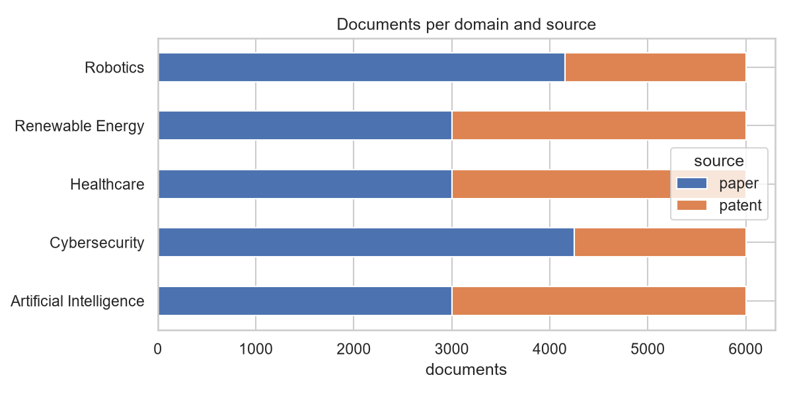
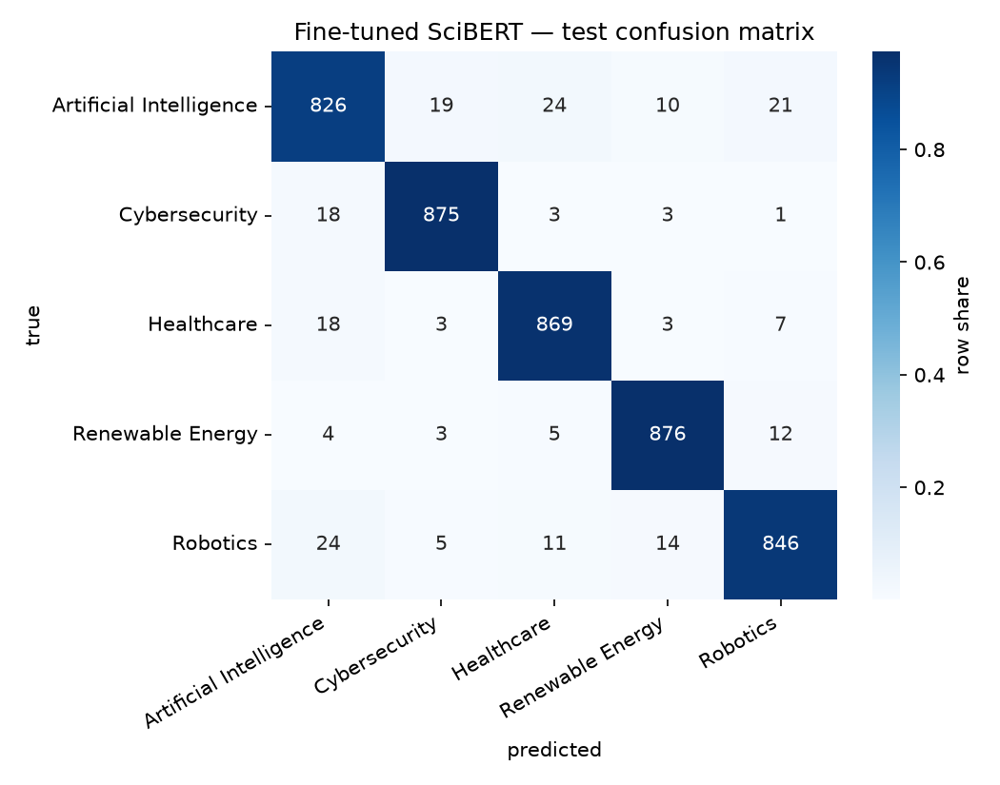
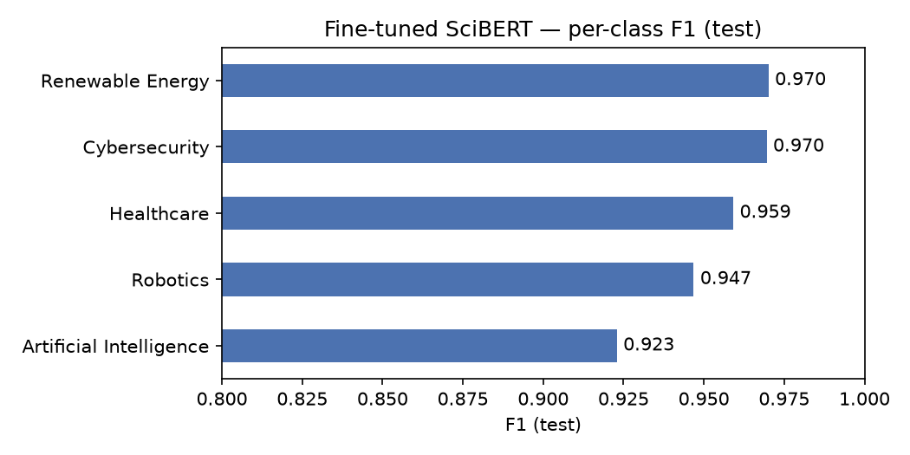
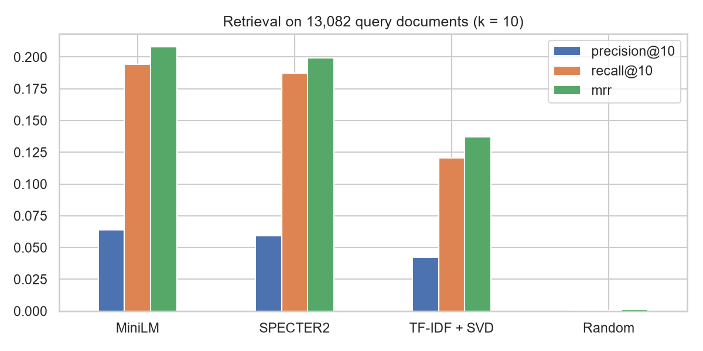
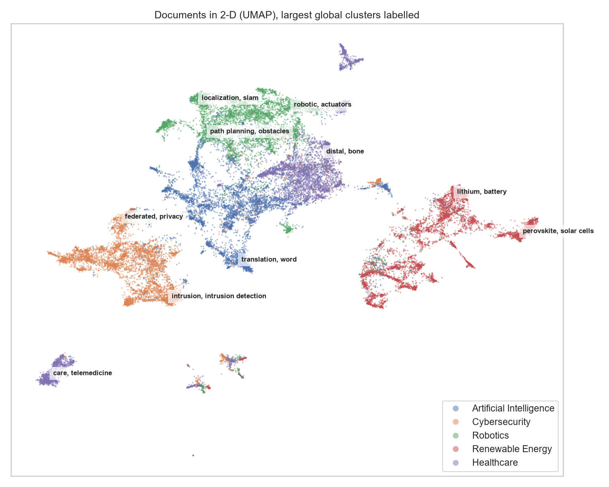
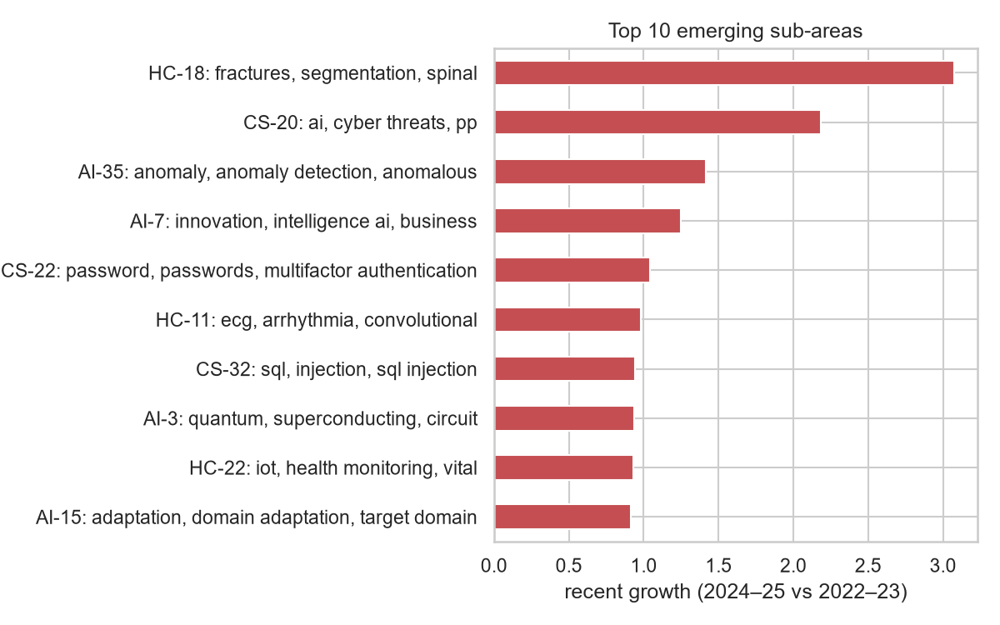
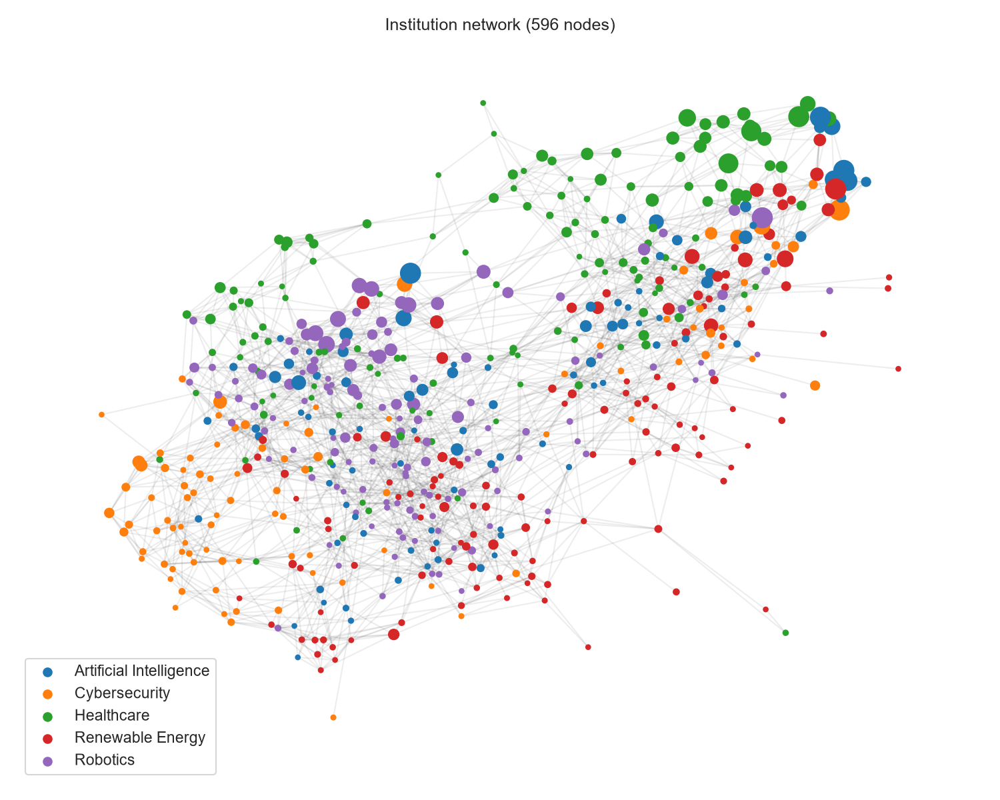

# Innovation Intelligence Platform — Evaluation Report

INT395 project. Every number below is read from the files in `reports/` written by the pipeline (`python scripts/make_report.py` regenerates this report).

## 1. Data

- **Patents:** Google Patents Public Datasets on BigQuery — granted US patents 2020–2025 with a university or research-institute assignee, original-English title and abstract, one per patent family. Label: primary CPC code, else first matching inventive CPC code, else a Y02E tag.
- **Papers:** OpenAlex journal articles with at least one university / research-institute author, labelled by primary topic (topic lists in `reports/label_sources.md`).
- **Cleaning:** 609 short or missing abstracts, 1,433 non-English abstracts and 212 duplicate titles removed.
- **Final dataset:** 30,000 documents, 5,763 institutions; largest domain share 20%; splits 21,000 / 4,500 / 4,500 (stratified, seed 42).

| domain | paper | patent |
|---|---|---|
| Artificial Intelligence | 3000 | 3000 |
| Cybersecurity | 4248 | 1752 |
| Healthcare | 3000 | 3000 |
| Renewable Energy | 3000 | 3000 |
| Robotics | 4158 | 1842 |

Patents available per domain after filtering: Artificial Intelligence 4,016, Healthcare 7,852, Robotics 1,869, Cybersecurity 1,787, Renewable Energy 5,679.

## 2. Embeddings

| model | dimension | seconds (30k docs, RTX 4050) |
|---|---|---|
| sentence-transformers/all-MiniLM-L6-v2 | 384 | 79.6 |
| allenai/specter2_base | 768 | 141.7 |

## 3. Domain classification (supervised)

Same split for every model; hyperparameters chosen on validation; the test split was used once, after all choices were frozen.

| model | val_accuracy | val_f1_macro | train_seconds |
|---|---|---|---|
| Fine-tuned SciBERT | 0.9500 | 0.9500 | 1,003.9 |
| SPECTER2 embeddings + Logistic Regression | 0.9367 | 0.9368 | 3.8000 |
| TF-IDF + Linear SVM | 0.9318 | 0.9319 | 7.6000 |
| MiniLM embeddings + Logistic Regression | 0.9313 | 0.9314 | 13.1 |
| TF-IDF + Logistic Regression | 0.9278 | 0.9279 | 15.4 |
| TF-IDF + Naive Bayes | 0.9053 | 0.9051 | 9.8000 |

**Test results**

| model | role | accuracy | precision_macro | recall_macro | f1_macro | f1_weighted |
|---|---|---|---|---|---|---|
| Fine-tuned SciBERT | best_model | 0.9538 | 0.9537 | 0.9538 | 0.9537 | 0.9537 |
| MiniLM embeddings + Logistic Regression | served_model | 0.9229 | 0.9227 | 0.9229 | 0.9228 | 0.9228 |

Leakage check: 0 documents contain a CPC code and 0 an OpenAlex topic ID in the model input (title + abstract only).

**Error analysis.** The most frequent test errors: Artificial Intelligence -> Healthcare (24); Robotics -> Artificial Intelligence (24); Artificial Intelligence -> Robotics (21); Artificial Intelligence -> Cybersecurity (19); Healthcare -> Artificial Intelligence (18); Cybersecurity -> Artificial Intelligence (18). They sit on domain boundaries (AI methods applied to medical data, learning-based robot control, ML for intrusion detection); 20 examples are listed in `misclassified_examples.csv`.

**Embedding choice.** SPECTER2 + Logistic Regression reaches validation macro F1 0.9368 vs 0.9314 for MiniLM, but MiniLM retrieves related documents better (MRR 0.2079 vs 0.1993) and runs under fastembed on the 512 MB backend, so MiniLM is the production embedding.

## 4. Similarity detection and semantic search

Ground truth: same primary CPC subgroup (patents, subgroups of 2-200 docs) or a citation link. 13,082 query documents, k = 10.

| embedding | precision@10 | recall@10 | mrr |
|---|---|---|---|
| minilm | 0.0639 | 0.1942 | 0.2079 |
| specter2 | 0.0595 | 0.1874 | 0.1993 |
| tfidf_svd_baseline | 0.0422 | 0.1205 | 0.1369 |
| random_baseline | 0.0004 | 0.0005 | 0.0014 |

Precision@10 is small in absolute terms because most documents have only one or two relevant documents in the corpus.

**Semantic search:** Precision@10 = 0.97 over 20 hand-written queries (per domain: Artificial Intelligence 0.95, Healthcare 0.90, Robotics 1.00, Cybersecurity 1.00, Renewable Energy 1.00).

**Cross-institution similarity:** threshold 0.59 (lowest score where >=95% of cross-institution neighbour pairs share a domain); 121,774 pairs flagged.

**Database check:** pgvector HNSW top-10 identical to FAISS for 100% of 100 test documents (median query 3.8 ms).

## 5. Clustering (unsupervised)

| scope | clusters | outlier_share | silhouette | NMI vs domain | ARI vs domain |
|---|---|---|---|---|---|
| global | 94 | 0.2679 | 0.0965 | 0.4814 | 0.1327 |
| Artificial Intelligence | 36 | 0.2130 | 0.0960 |  |  |
| Healthcare | 33 | 0.2587 | 0.1170 |  |  |
| Robotics | 33 | 0.2458 | 0.0813 |  |  |
| Cybersecurity | 39 | 0.2690 | 0.0948 |  |  |
| Renewable Energy | 20 | 0.0622 | 0.0803 |  |  |

Silhouette is low but positive (research topics form a continuum); ARI is low because 94 clusters split 5 domains into sub-areas, which NMI tolerates better. Clusters were named by Gemini (Phase 11), with keywords as fallback.

## 6. Emerging technologies

| rank | sub-area | domain | documents | growth 2024-25 vs 2022-23 | CAGR 2020-25 |
|---|---|---|---|---|---|
| 1 | Orthopedic Medical Image Analysis and Deep Learning | Healthcare | 82 | +308% | +34% |
| 2 | AI and Machine Learning in Cybersecurity | Cybersecurity | 131 | +219% | +39% |
| 3 | Anomaly Detection in Time Series and Sensor Data | Artificial Intelligence | 44 | +142% | +45% |
| 4 | AI and Business Innovation Technologies | Artificial Intelligence | 175 | +125% | +45% |
| 5 | User Authentication and Biometric Security | Cybersecurity | 98 | +104% | +16% |
| 6 | Deep Learning for Electrocardiogram Analysis | Healthcare | 161 | +98% | +36% |
| 7 | Web Application Vulnerabilities and Penetration Testing | Cybersecurity | 75 | +94% | +3% |
| 8 | Quantum Computing And Superconducting Circuits | Artificial Intelligence | 239 | +94% | +24% |
| 9 | Wearable Health Monitoring Systems | Healthcare | 132 | +93% | +8% |
| 10 | Domain Adaptation in Machine Learning | Artificial Intelligence | 124 | +92% | +30% |

**Back-test:** flag top 20 clusters by (n2022+n2023+1)/(n2020+n2021+1) using 2020-2023 only; hit = yearly average 2024-25 above 2022-23. Hit rate 0.70 vs 0.69 for clusters not flagged (20 flagged of 157). The two-year-window rule gives almost no lift over the base rate: most sub-areas grew over the period and clusters of 40–200 documents give noisy yearly counts, so the emerging list describes recent growth rather than predicting it.

## 7. Institutions

605 institutions with at least 10 documents are profiled (mean embedding). Network: 2,210 edges (similarity >= 0.8028 or >= 3 shared sub-areas, at most 8 per node). Most connected: advanced institute korea science technology, national seoul university, korea university, california university, texas university.

## 8. Changes from the original plan

See PLAN.md Section 10 (patent source moved from PatentsView to BigQuery; hybrid text table to stay under the 200 GB query cap; US grants only; extended labelling rule; non-English abstracts removed; Gemini model switched to a lighter one).
